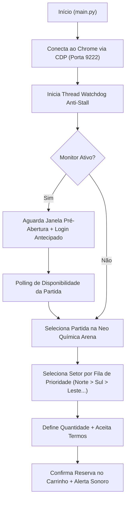

# Corinthians Ticket Bot — Automação RPA de Reserva de Ingressos


Automação web resiliente (**RPA — Robotic Process Automation**) desenvolvida em **Python + Selenium** para monitorar a abertura de vendas e automatizar a seleção de setor e reserva de ingressos de jogos do **Sport Club Corinthians Paulista (Neo Química Arena / Fiel Torcedor)**.

> [!NOTE]
> **Aviso Educacional:** Este projeto foi desenvolvido exclusivamente como estudo de caso prático de **Engenharia de Automação Web, Concorrência em Python e integração com Chrome DevTools Protocol (CDP)** para fins de aprendizado e portfólio técnico.

---

## Motivação e Problema Resolvido

Em aberturas de vendas de ingressos de alta demanda para jogos na **Neo Química Arena**, os setores mais disputados (como *Norte* e *Sul*) esgotam em poucos segundos e o tráfego intenso frequentemente causa lentidão ou travamentos na interface web.

Este projeto resolve esse cenário automatizando:
1. **Preparação e Login Antecipado:** Autentica a sessão minutos antes do horário oficial de abertura.
2. **Monitoramento Ativo (Polling):** Verifica continuamente a liberação das reservas em intervalos configuráveis.
3. **Algoritmo de Fallback por Prioridade de Setor:** Tenta o setor preferido (*ex.: Norte*) e, caso esteja esgotado, percorre automaticamente uma fila de prioridade (*Sul -> Leste Inferior -> Leste Superior -> Oeste Inferior*).
4. **Recuperação Automática contra Travamentos (Watchdog Thread):** Uma thread paralela monitora o estado do navegador e recupera a página caso o carregamento trave.

---

## Destaques Técnicos e Arquitetura

- **Conexão via Chrome DevTools Protocol (CDP):** Em vez de instanciar um navegador isolado do zero a cada execução, o módulo `bot/browser.py` conecta-se a uma sessão real do Chrome na porta `9222` (`debuggerAddress`), preservando estado, cookies e sessão do usuário.
- **Watchdog Multithread Anti-Stall:** Utiliza `threading.Thread` (daemon) sincronizada com `threading.Lock` para monitorar sinais de vida (`heartbeat`) do fluxo principal e acionar callbacks de recuperação (`refresh`) em caso de *timeout*.
- **Waits Explícitos e Interação Humanizada:** Uso de `WebDriverWait` + `expected_conditions` e `ActionChains` com cadência variável, evitando *race conditions* no DOM.
- **CLI Parametrizada:** Interface de linha de comando construída com `argparse` permitindo sobrescrever setor, número de tentativas, arquivo de configuração e modo de depuração.

### Fluxo de Execução



---

## Estrutura do Projeto e Acesso Rápido ao Código

Você pode navegar pelos arquivos diretamente no topo do repositório (ou baixar tudo pelo botão verde **`<> Code` -> Download ZIP**), clicar nos links abaixo ou expandir os seletores de código diretamente nesta página:

- [`main.py`](main.py) — Ponto de entrada, argumentos de linha de comando (`argparse`) e orquestração das etapas
- [`config.example.json`](config.example.json) — Modelo de configuração (setores da Neo Química Arena, horários e credenciais)
- [`start_chrome.bat`](start_chrome.bat) — Script para iniciar o Chrome com Remote Debugging (porta 9222)
- [`bot/browser.py`](bot/browser.py) — Conexão CDP na porta 9222, waits explícitos e thread de Watchdog anti-stall
- [`bot/ticket.py`](bot/ticket.py) — Seletores da página, fila de prioridade de setores da Arena e fluxo de reserva
- [`bot/monitor.py`](bot/monitor.py) — Contagem regressiva pré-venda, login antecipado e polling de abertura
- [`bot/login.py`](bot/login.py) — Preenchimento automatizado de credenciais com digitação humanizada
- [`bot/captcha.py`](bot/captcha.py) — Tratamento de desafios de verificação (modo manual interativo ou API)
- [`bot/notifier.py`](bot/notifier.py) — Alertas visuais e sonoros assíncronos (`winsound`)

<details>
<summary><strong>Ver código Python: main.py (Orquestrador Principal e CLI)</strong></summary>

```python
import os
import sys
import json
import time
import argparse
from colorama import init, Fore, Style

from bot.browser import criar_driver, iniciar_watchdog
from bot.login import fazer_login, clicar_botao_login, abrir_modal_login, verificar_login_ok
from bot.captcha import resolver_captcha_api, captcha_manual
from bot.ticket import fluxo_completo_reserva
from bot.notifier import notificar_sucesso, notificar_erro
from bot.monitor import aguardar_horario_abertura, monitorar_abertura, fazer_login_antecipado

init(autoreset=True)


def carregar_config(caminho="config.json"):
    if not os.path.exists(caminho) and os.path.exists("config.example.json"):
        print(Fore.YELLOW + f"[AVISO] '{caminho}' não encontrado — carregando 'config.example.json'.")
        caminho = "config.example.json"

    with open(caminho, encoding="utf-8") as f:
        return json.load(f)


def executar_reserva(driver, config, url_override=None, modo_debug=False):
    creds = config["credentials"]
    captcha_cfg = config["captcha"]

    if url_override:
        config["target"]["event_url"] = url_override

    print(Fore.YELLOW + "\n--- ETAPA 1: NAVEGACAO E SELECAO DE SETOR (NEO QUIMICA ARENA) ---")
    if not fluxo_completo_reserva(driver, config):
        notificar_erro("Não foi possível concluir a seleção do ingresso")
        return False

    print(Fore.YELLOW + "\n--- ETAPA 2: VALIDACAO DE SESSAO ---")
    if not verificar_login_ok(driver):
        abrir_modal_login(driver)
        time.sleep(1.5)
        login_user = creds.get("login") or creds.get("email", "")
        fazer_login(driver, login_user, creds["password"])

        captcha_ok = False
        if captcha_cfg.get("service") == "2captcha" and captcha_cfg.get("api_key"):
            captcha_ok = resolver_captcha_api(driver, captcha_cfg["api_key"])
        if not captcha_ok:
            captcha_ok = captcha_manual(driver, timeout=120)
        if not captcha_ok:
            notificar_erro("Verificação de segurança não concluída a tempo")
            return False

        clicar_botao_login(driver)
        time.sleep(3)

    notificar_sucesso(f"INGRESSO RESERVADO COM SUCESSO! URL: {driver.current_url}")
    return True
```
</details>

<details>
<summary><strong>Ver código Python: bot/ticket.py (Seletores e Prioridade de Setores da Arena)</strong></summary>

```python
import time
import random
from selenium.webdriver.common.by import By
from bot.browser import esperar_clicavel, clique_humano, aceitar_cookies

# SELETORES DE MAPEAMENTO DA INTERFACE E SETORES DA NEO QUIMICA ARENA
SEL_BTN_PARTIDA = (
    "//a[contains(text(),'Comprar') or contains(text(),'Reservar') or contains(text(),'INGRESSOS') or contains(@class,'tmpe-link-details')]"
    " | //button[contains(text(),'Comprar') or contains(text(),'Reservar') or contains(@class,'next')]"
)
SEL_BTN_MAIS_CSS = ".plus, button.btn-number.plus, button[aria-label*='Adicionar']"
SEL_BTN_MAIS_XPATH = "//button[contains(@class,'plus') or normalize-space(text())='+']"
SEL_BTN_CONTINUAR_XPATH = (
    "//a[contains(@class,'next') or contains(text(),'Continuar') or contains(text(),'Próximo') or contains(text(),'Avançar')]"
    " | //button[contains(@class,'next') or contains(text(),'Continuar') or contains(text(),'Próximo') or contains(text(),'Reservar')]"
)
SEL_TERMOS_XPATH = (
    "//a[contains(text(),'Eu aceito') or contains(text(),'Aceitar')]"
    " | //button[contains(text(),'Eu aceito') or contains(text(),'Aceitar')]"
    " | //label[contains(text(),'termos') or contains(text(),'Li e concordo')]"
)

SETORES_PADRAO_ARENA = [
    "Norte",
    "Sul",
    "Leste Inferior",
    "Leste Superior",
    "Oeste Inferior",
    "Oeste Superior",
]


def selecionar_setor_por_prioridade(driver, setor_preferido="Norte", lista_prioridade=None):
    prioridades = [setor_preferido] if setor_preferido else []
    for s in (lista_prioridade or SETORES_PADRAO_ARENA):
        if s not in prioridades:
            prioridades.append(s)

    print(f"[INFO] Ordem de prioridade de setores: {' > '.join(prioridades)}")

    for setor in prioridades:
        print(f"[INFO] Tentando setor: {setor}...")
        elementos = driver.find_elements(By.XPATH, f"//*[contains(text(), '{setor}')]")
        for el in elementos:
            texto_bloco = (el.text or "").upper()
            if "ESGOTADO" in texto_bloco or "INDISPONÍVEL" in texto_bloco:
                continue
            if el.is_displayed():
                clique_humano(driver, el)
                time.sleep(1.2)
                print(f"[OK] Setor '{setor}' selecionado com sucesso!")
                return True
    return True
```
</details>

<details>
<summary><strong>Ver código Python: bot/browser.py (Conexão Chrome CDP Porta 9222 e Watchdog Thread)</strong></summary>

```python
import time
import random
import threading
from selenium import webdriver
from selenium.webdriver.chrome.options import Options

DEBUG_PORT = 9222
_watchdog_lock = threading.Lock()
_ultimo_sinal_vida = time.time()


def criar_driver(headless=False, page_load_timeout=30):
    options = Options()
    options.add_experimental_option("debuggerAddress", f"127.0.0.1:{DEBUG_PORT}")
    driver = webdriver.Chrome(options=options)
    driver.set_page_load_timeout(page_load_timeout)
    return driver


def iniciar_watchdog(driver, timeout_segundos=60, callback=None):
    def _watch():
        global _ultimo_sinal_vida
        while True:
            time.sleep(10)
            with _watchdog_lock:
                inativo_ha = time.time() - _ultimo_sinal_vida
            if inativo_ha > timeout_segundos and callback:
                callback(driver)
                with _watchdog_lock:
                    _ultimo_sinal_vida = time.time()

    t = threading.Thread(target=_watch, daemon=True)
    t.start()
    return t
```
</details>

```text
corinthians-ticket-bot/
├── main.py                  # Ponto de entrada e CLI (argparse)
├── config.example.json      # Modelo de configuração (setores, horários e credenciais)
├── requirements.txt         # Dependências do projeto
├── start_chrome.bat         # Script para iniciar o Chrome com Remote Debugging (porta 9222)
└── bot/
    ├── __init__.py
    ├── browser.py           # Conexão CDP, waits explícitos e Watchdog Thread
    ├── monitor.py           # Contagem regressiva, login antecipado e polling de abertura
    ├── ticket.py            # Seleção de partida, fallback de setores da Arena e reserva
    ├── login.py             # Preenchimento automatizado de credenciais
    ├── captcha.py           # Tratamento de verificações de segurança (manual/API)
    └── notifier.py          # Alertas visuais e sonoros assíncronos (winsound)
```

---

## Como Executar

### 1. Clonar o repositório e instalar dependências
```bash
git clone https://github.com/ccrazyjapinha-debug/corinthians-ticket-bot.git
cd corinthians-ticket-bot
pip install -r requirements.txt
```

### 2. Configurar parâmetros da partida
Copie o arquivo `config.example.json` para `config.json` (o arquivo `config.json` é ignorado pelo `.gitignore` para proteger suas credenciais):
```bash
copy config.example.json config.json
```

Edite o `config.json` com a partida e a ordem de setores desejada:
```json
{
  "target": {
    "match_name": "Corinthians x Palmeiras — Campeonato Brasileiro",
    "stadium": "Neo Química Arena",
    "event_url": "https://www.fieltorcedor.com.br/jogos",
    "ticket_type": "Fiel Torcedor",
    "setor_preferido": "Norte",
    "setores_por_prioridade": [
      "Norte",
      "Sul",
      "Leste Inferior",
      "Leste Superior",
      "Oeste Inferior"
    ],
    "quantity": 1
  }
}
```

### 3. Iniciar o Chrome em modo Remote Debugging
Execute o script `.bat` para abrir o Google Chrome na porta `9222`:
```cmd
start_chrome.bat
```

### 4. Executar o Bot
```bash
# Modo completo (aguarda horário + monitora abertura + reserva)
python main.py

# Executar reserva imediatamente (pula o monitor de horário)
python main.py --sem-monitor

# Definir o setor prioritário direto pela linha de comando
python main.py --sem-monitor --setor "Sul" --tentativas 3

# Modo debug (mantém inspeção ativa ao finalizar)
python main.py --debug
```

---

## Autor

**Alison Luiz Padilha**  
Estudante de Análise e Desenvolvimento de Sistemas | Foco em Desenvolvimento de Software & Dados  
- [LinkedIn](https://www.linkedin.com/in/alison-luiz-padilha)
- [GitHub](https://github.com/ccrazyjapinha-debug)
