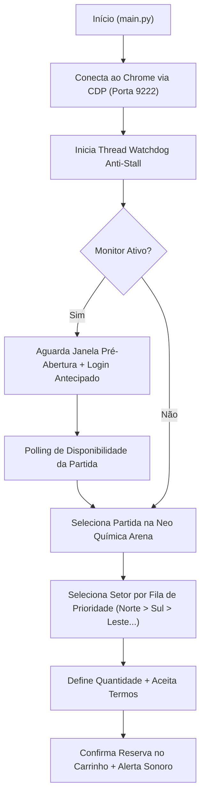

# 🦅 Corinthians Ticket Bot — Automação RPA de Reserva de Ingressos


Automação web resiliente (**RPA — Robotic Process Automation**) desenvolvida em **Python + Selenium** para monitorar a abertura de vendas e automatizar a seleção de setor e reserva de ingressos de jogos do **Sport Club Corinthians Paulista (Neo Química Arena / Fiel Torcedor)**.

> [!NOTE]
> **Aviso Educacional:** Este projeto foi desenvolvido exclusivamente como estudo de caso prático de **Engenharia de Automação Web, Concorrência em Python e integração com Chrome DevTools Protocol (CDP)** para fins de aprendizado e portfólio técnico.

---

## 🎯 Motivação e Problema Resolvido

Em aberturas de vendas de ingressos de alta demanda para jogos na **Neo Química Arena**, os setores mais disputados (como *Norte* e *Sul*) esgotam em poucos segundos e o tráfego intenso frequentemente causa lentidão ou travamentos na interface web.

Este projeto resolve esse cenário automatizando:
1. **Preparação e Login Antecipado:** Autentica a sessão minutos antes do horário oficial de abertura.
2. **Monitoramento Ativo (Polling):** Verifica continuamente a liberação das reservas em intervalos configuráveis.
3. **Algoritmo de Fallback por Prioridade de Setor:** Tenta o setor preferido (*ex.: Norte*) e, caso esteja esgotado, percorre automaticamente uma fila de prioridade (*Sul → Leste Inferior → Leste Superior → Oeste Inferior*).
4. **Recuperação Automática contra Travamentos (Watchdog Thread):** Uma thread paralela monitora o estado do navegador e recupera a página caso o carregamento trave.

---

## ⚙️ Destaques Técnicos e Arquitetura

- **Conexão via Chrome DevTools Protocol (CDP):** Em vez de instanciar um navegador isolado do zero a cada execução, o módulo `bot/browser.py` conecta-se a uma sessão real do Chrome na porta `9222` (`debuggerAddress`), preservando estado, cookies e sessão do usuário.
- **Watchdog Multithread Anti-Stall:** Utiliza `threading.Thread` (daemon) sincronizada com `threading.Lock` para monitorar sinais de vida (`heartbeat`) do fluxo principal e acionar callbacks de recuperação (`refresh`) em caso de *timeout*.
- **Waits Explícitos e Interação Humanizada:** Uso de `WebDriverWait` + `expected_conditions` e `ActionChains` com cadência variável, evitando *race conditions* no DOM.
- **CLI Parametrizada:** Interface de linha de comando construída com `argparse` permitindo sobrescrever setor, número de tentativas, arquivo de configuração e modo de depuração.

### Fluxo de Execução



---

## 📁 Estrutura do Projeto

```text
corinthians-ticket-bot/
├── main.py                  # Ponto de entrada e CLI (argparse)
├── config.example.json      # Modelo de configuração (setores, horários e credenciais)
├── requirements.txt         # Dependências do projeto
├── start_chrome.bat         # Script para iniciar o Chrome com Remote Debugging (porta 9222)
└── bot/
    ├── __init__.py
    ├── browser.py           # Conexão CDP, waits explícitos e Watchdog Thread
    ├── monitor.py           # Contagem regressiva, login antecipado e polling de abertura
    ├── ticket.py            # Seleção de partida, fallback de setores da Arena e reserva
    ├── login.py             # Preenchimento automatizado de credenciais
    ├── captcha.py           # Tratamento de verificações de segurança (manual/API)
    └── notifier.py          # Alertas visuais e sonoros assíncronos (winsound)
```

---

## 🚀 Como Executar

### 1. Clonar o repositório e instalar dependências
```bash
git clone https://github.com/ccrazyjapinha-debug/corinthians-ticket-bot.git
cd corinthians-ticket-bot
pip install -r requirements.txt
```

### 2. Configurar parâmetros da partida
Copie o arquivo `config.example.json` para `config.json` (o arquivo `config.json` é ignorado pelo `.gitignore` para proteger suas credenciais):
```bash
copy config.example.json config.json
```

Edite o `config.json` com a partida e a ordem de setores desejada:
```json
{
  "target": {
    "match_name": "Corinthians x Palmeiras — Campeonato Brasileiro",
    "stadium": "Neo Química Arena",
    "event_url": "https://www.fieltorcedor.com.br/jogos",
    "ticket_type": "Fiel Torcedor",
    "setor_preferido": "Norte",
    "setores_por_prioridade": [
      "Norte",
      "Sul",
      "Leste Inferior",
      "Leste Superior",
      "Oeste Inferior"
    ],
    "quantity": 1
  }
}
```

### 3. Iniciar o Chrome em modo Remote Debugging
Execute o script `.bat` para abrir o Google Chrome na porta `9222`:
```cmd
start_chrome.bat
```

### 4. Executar o Bot
```bash
# Modo completo (aguarda horário + monitora abertura + reserva)
python main.py

# Executar reserva imediatamente (pula o monitor de horário)
python main.py --sem-monitor

# Definir o setor prioritário direto pela linha de comando
python main.py --sem-monitor --setor "Sul" --tentativas 3

# Modo debug (mantém inspeção ativa ao finalizar)
python main.py --debug
```

---

## 👨‍💻 Autor

**Alison Luiz Padilha**  
Estudante de Análise e Desenvolvimento de Sistemas | Foco em Desenvolvimento de Software & Dados  
- [LinkedIn](https://www.linkedin.com/in/alison-luiz-padilha)
- [GitHub](https://github.com/ccrazyjapinha-debug)
